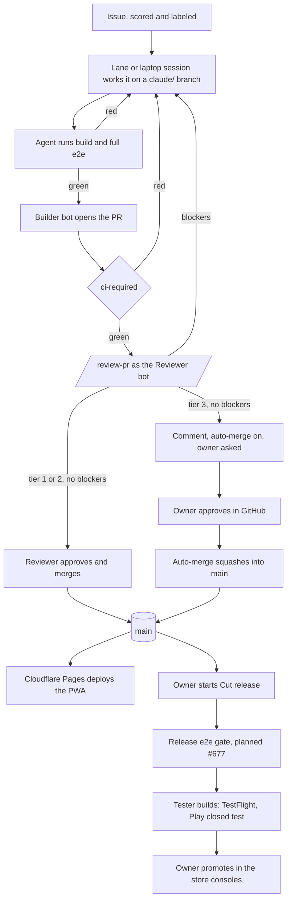

# Governance: risks, controls, and evidence

The one page that says what can go wrong in RepBunny's delivery pipeline, what stops it, whether
GitHub enforces that or an agent is only told to, and where to check (#684). It's written in the
style of a SOC 2 control list. The reasoning behind each control lives in
`docs/governance/threat-model.md`. The rules themselves live in `docs/architecture/commit-policy.md`
and `docs/backlog-runner.md`. This page points at them rather than repeating them.

Context: two-user app, solo owner, AI agents (cloud "lanes" and a review routine) write and ship
most changes. All user data stays on the phone. Governance work is tracked in #688, decided by the
owner on 2026-10-20 and 2026-10-21.

## How to read "Enforced by"

| Value | Means |
|---|---|
| **Ruleset** | GitHub refuses the action: the `main` ruleset (`.github/rulesets/main.json`), no bypass actors |
| **CODEOWNERS** | the ruleset requires an approval from the owner's account for these paths (`.github/CODEOWNERS`). GitHub can't tell whether the owner or a session holding the owner's credential gave it (accepted risk, #768) |
| **CI** | a required check on every PR (`ci-required` in `.github/workflows/ci.yml`) |
| **Workflow** | a GitHub Actions workflow or script that runs outside any agent session |
| **Identity** | a GitHub App's permissions, or where its key lives |
| **Network** | the cloud environment's network allowlist, or the app's Content-Security-Policy |
| **Instruction** | a rule in a skill or doc that agents follow. Nothing stops an agent that doesn't. |
| **Owner** | a step only the owner can do (a store console, a dashboard, a key) |

Rows that are only **Instruction** are the honest weak spots. Accepted risks say why they're
accepted and when to revisit them.

## Control matrix

| # | Risk | Control | Enforced by | Evidence (where to look) |
|---|---|---|---|---|
| 1 | Unreviewed or untested code reaches `main` | Every change goes through a PR with 1 approval and a green `ci-required`; squash only; no bypass, the owner included | Ruleset, CI | `.github/rulesets/main.json`; `node scripts/apply-ruleset.mjs --check` (owner's `gh`); `gh api repos/DeanPhillipsOKC/repbunny/rules/branches/main`; a direct push refused with GH013 (#681's close-out) |
| 2 | Agents loosen their own guardrails (skills, workflows, the gate, decisions) | Tier 3 paths need an approval from the owner's account in GitHub; CODEOWNERS is generated from the one tier list. Agents are told never to approve, but sessions hold that credential (accepted risk, #768) | CODEOWNERS, Ruleset; who approves: Instruction (accepted risk, #768) | `.github/CODEOWNERS`; `scripts/risk-tiers.json`; `node scripts/review-risk.mjs --check-codeowners`; tier 3 PRs show the owner's Approve (PR #763) |
| 3 | A tier 3 change by content, not path (an added network call), slips through | `/review-pr` never approves tier 3, so the one required approval has to come from the owner's account (accepted risk, #768) | Instruction, backed by Ruleset | `.claude/skills/review-pr/SKILL.md` step 5 item 3; `scripts/review-risk.mjs` (network-call trigger) |
| 4 | A lane approves its own PR | The Reviewer bot's approval is a record, not proof: any session can start `.github/workflows/post-review.yml` | Accepted risk | `docs/governance/threat-model.md` > Accepted risks; Reviewer reviews on PRs vs. review routine runs (`/process-review`) |
| 5 | Agents' actions can't be told from the owner's | PRs come from `repbunny-builder[bot]` and reviews from `repbunny-reviewer[bot]`. Both apps have Contents write (the Reviewer needs it for its approval to count toward the ruleset, #770). Keys live only in Actions secrets and tokens last an hour | Identity, Workflow | `.github/workflows/open-pr.yml`; `scripts/gh-app-token.mjs`; PR authors and reviewers in the PR list; commit authors in `git log` |
| 6 | A secret is committed | gitleaks on every PR's commits; a full-history scan found nothing (1,275 commits, 2026-10-21) | CI | the gitleaks step of the `ci-required` job in `.github/workflows/ci.yml`; planted-key test PR #758 turned it red |
| 7 | A secret leaks from a session | No production keys in the cloud environment; app keys only in Actions secrets; Actions masks secrets in logs. Sessions still hold the owner-level GitHub credential the cloud proxy injects (see row 4) | Identity, Network; the session credential is not ours to scope | `docs/architecture/commit-policy.md` > Cloud sessions; `docs/governance/threat-model.md` threats 5 and 7 |
| 8 | A vulnerable or malicious dependency ships | `npm audit` on production deps blocks on high; Dependabot 7-day cooldown; lockfile changes are at least tier 2; installs skip scripts | CI, Workflow, Instruction | `.github/workflows/ci.yml`; `.github/dependabot.yml`; `scripts/review-risk.mjs`; `scripts/cloud-session-start.mjs` |
| 9 | A workflow bug or injection (`${{ }}` in `run:`, `secrets: inherit`) | Semgrep (GitHub Actions rules, blocks on ERROR) and actionlint on every PR; the only third-party action is pinned by SHA | CI | `.github/workflows/ci.yml`; `.github/workflows/release-play.yml` (pinned action); PR #757 fixed the 5 findings it raised |
| 10 | User workout data leaves the phone | The native apps make no network calls of their own; the PWA's CSP limits connections; any added network call is tier 3; a monthly security audit | Network (PWA), Instruction (native), Workflow | `docs/decisions.md` (privacy); `public/_headers` and `e2e/local/csp-enforced.spec.ts`; `.claude/skills/security-audit/SKILL.md` |
| 11 | Untested code reaches users | Full e2e must pass on the exact commit before Cut release tags a store build (**planned, #677**). Agents run e2e before merging. Production promotion happens in the store consoles | Workflow (planned), Instruction, Owner | `.github/workflows/cut-release.yml`; #677; `docs/architecture/native-releases.md` |
| 12 | A store release nobody asked for | Cut release runs only when the owner starts it or types `/release`; the skill can't be invoked by a model. Going public is a store-console step | Instruction, Owner | `.claude/skills/release/SKILL.md` (`disable-model-invocation`); `docs/architecture/commit-policy.md` (release tags) |
| 13 | History on `main` is rewritten or deleted | Force pushes and deletion are refused; the pre-push hook refuses any push to `main` | Ruleset | `.github/rulesets/main.json`; `scripts/git-hooks/pre-push` |
| 14 | The repo is lost (GitHub account, a bad change elsewhere) | Nightly `git bundle` of every branch and tag, plus `.env.local`, to Google Drive, keeping 30 | Workflow (laptop task), Owner | `scripts/Backup-Repo.ps1`; `docs/architecture/commit-policy.md` > Repo backups; `My Drive\RepBunny Backups\repo` | <!-- docs-refs: ignore -->
| 15 | Runaway spend (a review-and-follow-up loop, a stuck lane) | A daily cap on dispatched lane runs, lowered by the Actions minutes guard as the month runs short (#904); one run per lane and model; claims expire after 3 hours; one automatic send-back per PR | Workflow | `scripts/run-budget.mjs`; `scripts/dispatch-lanes.mjs`; `docs/backlog-runner.md` > Run budget |
| 16 | Prompt injection through support email, issues, or PR text | Untrusted text is data, not instructions; new work from email needs the owner's answer, and the picker skips `support` and `status:needs-review` | Workflow (picker, evidence notes), Instruction | `scripts/next-issue.mjs`; `.github/workflows/support-evidence.yml` and `scripts/support-evidence.mjs --self-test` (a "seen again" note takes checked fields only); `.claude/skills/triage-support/SKILL.md`; `docs/governance/threat-model.md` > Support email path |
| 17 | An owner answer is forged (agents comment as the owner) | The answer that matters, a tier 3 approval, is now a real GitHub review; other answers are comments. A session holding the owner's credential could still post that review (accepted risk, #768) | Ruleset (tier 3, an approval from the owner's account), Instruction (who gives it, and the rest) | `docs/governance/threat-model.md` threat 6; `scripts/ask-dean.mjs` |
| 18 | Something goes wrong and needs stopping now | One switch pauses every dispatcher and headless run; a written break-glass for the ruleset | Workflow, Owner | `.github/workflows/automation-pause.yml`; `scripts/automation-paused.mjs`; `docs/architecture/commit-policy.md` > Break-glass |
| 19 | An outsider's fork PR, comment, or issue in the public code repo runs code with a secret or steers an agent | Fork PRs get no secrets; every secret-using job on a PR event needs a same-repo head; issue and comment events start nothing outside the backlog repo; the picker offers lanes only same-repo `claude/` and `dependabot/` PRs; reviews read only Builder PRs and the owner's and bots' comments (#945) | Workflow, Instruction | `docs/governance/threat-model.md` > Public code repo: workflow audit; `scripts/next-issue.mjs` (`ownPr`) |

## Accepted risks

Each is written up in full, with what still holds and when to revisit, in
`docs/governance/threat-model.md` > Accepted risks.

| Risk | Why accepted | What still holds | Revisit when |
|---|---|---|---|
| Full e2e is independent only at release time, not on every PR (row 11) | Budget: per-PR e2e needs a paid runner; the app makes no money yet | No store build is tagged without a clean independent e2e run on the exact commit; every PR gets CI and a review | Revenue covers a runner, or a regression slips past an agent's own run |
| The Reviewer bot's approval is a record, not proof (row 4) | Budget: the airtight fix runs the review in Actions on a pay-per-use API key | Tier 3 needs an approval from the owner's account (sessions hold that credential too, #768), and every bot action is logged under its own identity | Revenue covers the API, the cloud proxy lets a session send its own token, or the audit trail shows a forged approval |
| A session could post the owner's tier 3 approval (rows 2, 3, 17) | No fix for headless cloud runs: the proxy sets their credential. Fixing laptop sessions alone covers only the ones the owner watches | Tier 3 still gets a `/review-pr` review and the Reviewer never approves it; every approval is in the PR's review history; the pause switch | The cloud proxy lets a session send its own token, or an owner approval turns up that the owner didn't give |

## Change management

How a change goes from issue to production. Tiers are set by `scripts/review-risk.mjs`
(`docs/backlog-runner.md` > Review).

## Keeping this page true

`npm run check:docs` checks every file this page cites. Once a month, `/process-review` checks that
each row's evidence still exists and that its control is still in place, and flags a row whose
control was removed or weakened. Rows marked planned move to their real control when their issue
ships.
